import { Card, CardGrid, LinkCard, Tabs, TabItem } from "@astrojs/starlight/components";

## Why Apis

<CardGrid>
  <Card title="Full Plugin Compatibility" icon="puzzle">
    Bukkit, Spigot, and Paper plugins run out of the box. The public API stays intact, including packet-heavy plugins like ProtocolLib, GrimAC, and LuckPerms.
  </Card>
  <Card title="System Kill-Switches" icon="setting">
    Disable unused mechanics in [configs/apis.yml](/configuration/apis-config/): mob AI, redstone, block physics, advancements, recipes, or disk world saving, without plugin NPEs.
  </Card>
  <Card title="Fast Boot & Low Overhead" icon="rocket">
    Clean boot takes under 2 seconds. Built-in manifest classpath works directly with [Java 25+ AOT Cache](/internals/aot/), alongside optimized networking for high player counts.
  </Card>
  <Card title="Built-in Worlds (No Multiverse)" icon="open-book">
    Isolated [worlds/](/worlds/standalone-mode/) directory with Void generation, per-world `world.yml` config for spawn/gamemode, `/world` + `/tpworld` commands, and optional RAM-only mode.
  </Card>
</CardGrid>

## Apis vs Paper in Practice

Stock Paper keeps full survival systems running even on servers that do not need them - lobbies, hubs, queues, or minigames. Tested with the same 9-plugin stack (`LuckPerms`, `TAB`, `Skript`, `WorldEdit`, `GrimAC`, `ViaVersion`, `PacketEvents`) in Docker (`4 vCPU`, `4 GiB RAM`, `Java 25` with AOT):

<Tabs>
  <TabItem label="Scaling (up to 350 players)">
    
  </TabItem>
  <TabItem label="Stability at 100 players">
    
  </TabItem>
  <TabItem label="Boot Time & Idle RAM">
    
  </TabItem>
</Tabs>

| Spark Profile | Link |
| --- | --- |
| 350 bots step test | <a href="https://spark.lucko.me/OLVVRmk3ST" target="_blank" rel="noopener noreferrer">spark.lucko.me/OLVVRmk3ST</a> |
| Direct join 250 bots #1 | <a href="https://spark.lucko.me/rzHe0FAdrg" target="_blank" rel="noopener noreferrer">spark.lucko.me/rzHe0FAdrg</a> |
| Direct join 250 bots #2 | <a href="https://spark.lucko.me/YY7uUqBydH" target="_blank" rel="noopener noreferrer">spark.lucko.me/YY7uUqBydH</a> |
| Direct join 250 bots #3 | <a href="https://spark.lucko.me/a7dZyQC10D" target="_blank" rel="noopener noreferrer">spark.lucko.me/a7dZyQC10D</a> |
| Fast join 250 bots (`12/s`) | <a href="https://spark.lucko.me/3BNUnI8mob" target="_blank" rel="noopener noreferrer">spark.lucko.me/3BNUnI8mob</a> |

See the full methodology and raw numbers in [Plugin Impact & Benchmarks](/practice/plugins-impact/).

<CardGrid>
  <LinkCard
    title="Migrating from Paper"
    description="Step-by-step guide to moving an existing server to Apis directory layout."
    href="/getting-started/migration/"
  />
  <LinkCard
    title="Directory Structure & CLI Flags"
    description="Layout of configs/, addons/, plugins/, users/, cache/, and startup args."
    href="/getting-started/directory-structure/"
  />
  <LinkCard
    title="configs/apis.yml Reference"
    description="All core toggles, defaults, and ApisConfigSync rules."
    href="/configuration/apis-config/"
  />
  <LinkCard
    title="Kill-Switches Internals"
    description="What each toggle disables and how fallback objects prevent plugin crashes."
    href="/configuration/kill-switches/"
  />
</CardGrid>
