import { Card, CardGrid, LinkCard, Tabs, TabItem } from "@astrojs/starlight/components";

## Чому саме Apis

<CardGrid>
  <Card title="Сумісність із плагінами" icon="puzzle">
    Усі плагіни під Bukkit, Spigot і Paper працюють без змін: публічний API збережено на 100%, а складні плагіни на кшталт ProtocolLib, GrimAC чи LuckPerms працюють стабільно й без модифікацій.
  </Card>
  <Card title="Вимкнення зайвих механік" icon="setting">
    У [configs/apis.yml](/uk/configuration/apis-config/) можна вимкнути все, що не потрібне на лобі чи арені: AI мобів, редстоун, фізику блоків, досягнення, рецепти чи збереження світу - без падінь і помилок у плагінах.
  </Card>
  <Card title="Швидкий запуск і низьке навантаження" icon="rocket">
    Чистий старт менш ніж за 2 секунди, адаптована структура для спрощеної генерації [Java 25+ AOT-кешу](/uk/internals/aot/) та оптимізована мережева підсистема під високий онлайн.
  </Card>
  <Card title="Вбудовані світи замість Multiverse" icon="open-book">
    Окрема тека [worlds/](/uk/worlds/standalone-mode/) з порожнім Void-світом, файлом `world.yml` для спавну та режиму гри, командами `/world` і `/tpworld`, а також роботою без запису на диск.
  </Card>
</CardGrid>

## Apis проти Paper на практиці

Звичайний Paper тримає активними всі системи ванільного виживання навіть на серверах, де вони не потрібні - у лобі, хабах, чергах або мінііграх. У тестах на однаковому наборі з 9 плагінів (`LuckPerms`, `TAB`, `Skript`, `WorldEdit`, `GrimAC`, `ViaVersion`, `PacketEvents`) у Docker (`4 vCPU`, `4 GiB RAM`, `Java 25` з AOT):

<Tabs>
  <TabItem label="Витривалість (до 350 гравців)">
    
  </TabItem>
  <TabItem label="Стабільність при 100 гравцях">
    
  </TabItem>
  <TabItem label="Швидкість запуску та пам'ять">
    
  </TabItem>
</Tabs>

| Spark-профіль | Посилання |
| --- | --- |
| 350 ботів, кроковий тест | <a href="https://spark.lucko.me/OLVVRmk3ST" target="_blank" rel="noopener noreferrer">spark.lucko.me/OLVVRmk3ST</a> |
| Прямий вхід 250 ботів #1 | <a href="https://spark.lucko.me/rzHe0FAdrg" target="_blank" rel="noopener noreferrer">spark.lucko.me/rzHe0FAdrg</a> |
| Прямий вхід 250 ботів #2 | <a href="https://spark.lucko.me/YY7uUqBydH" target="_blank" rel="noopener noreferrer">spark.lucko.me/YY7uUqBydH</a> |
| Прямий вхід 250 ботів #3 | <a href="https://spark.lucko.me/a7dZyQC10D" target="_blank" rel="noopener noreferrer">spark.lucko.me/a7dZyQC10D</a> |
| Швидкий вхід 250 ботів (`12/с`) | <a href="https://spark.lucko.me/3BNUnI8mob" target="_blank" rel="noopener noreferrer">spark.lucko.me/3BNUnI8mob</a> |

Усі деталі методики та повні результати тестів дивіться у статті [Вплив плагінів та реальні бенчмарки](/uk/practice/plugins-impact/).

<CardGrid>
  <LinkCard
    title="Міграція з Paper"
    description="Як перенести наявний сервер на нову структуру папок."
    href="/uk/getting-started/migration/"
  />
  <LinkCard
    title="Структура каталогів та CLI-прапорці"
    description="Призначення configs/, addons/, plugins/, users/, cache/ і прапорців запуску."
    href="/uk/getting-started/directory-structure/"
  />
  <LinkCard
    title="Налаштування configs/apis.yml"
    description="Довідник усіх параметрів ядра та синхронізація ApisConfigSync."
    href="/uk/configuration/apis-config/"
  />
  <LinkCard
    title="Вимкнення систем (Kill-Switches)"
    description="Які механіки можна вимкнути та як гарантується сумісність із плагінами."
    href="/uk/configuration/kill-switches/"
  />
</CardGrid>
